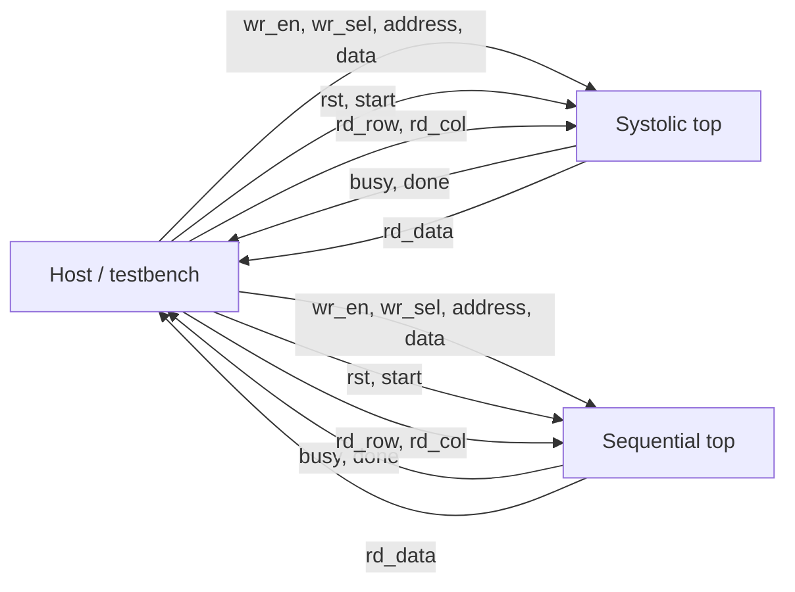
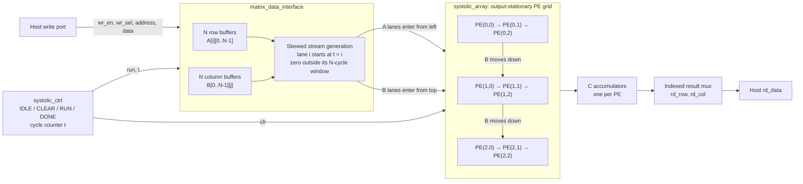
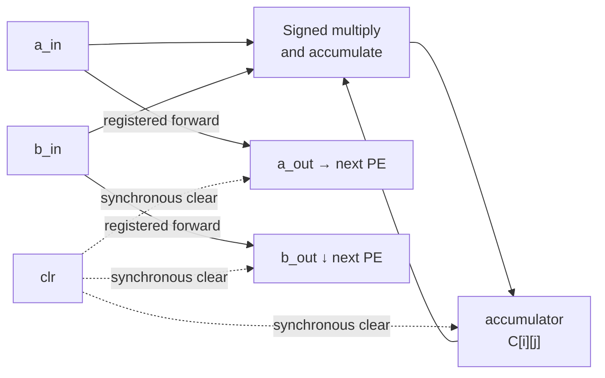
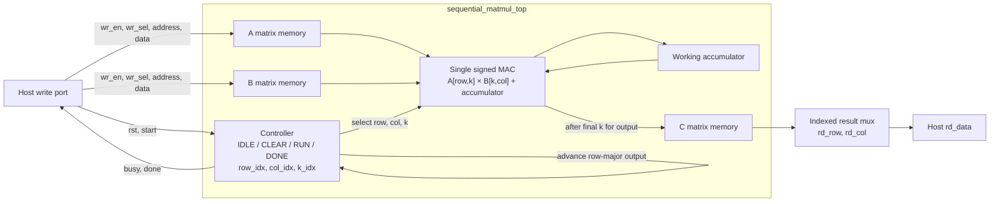
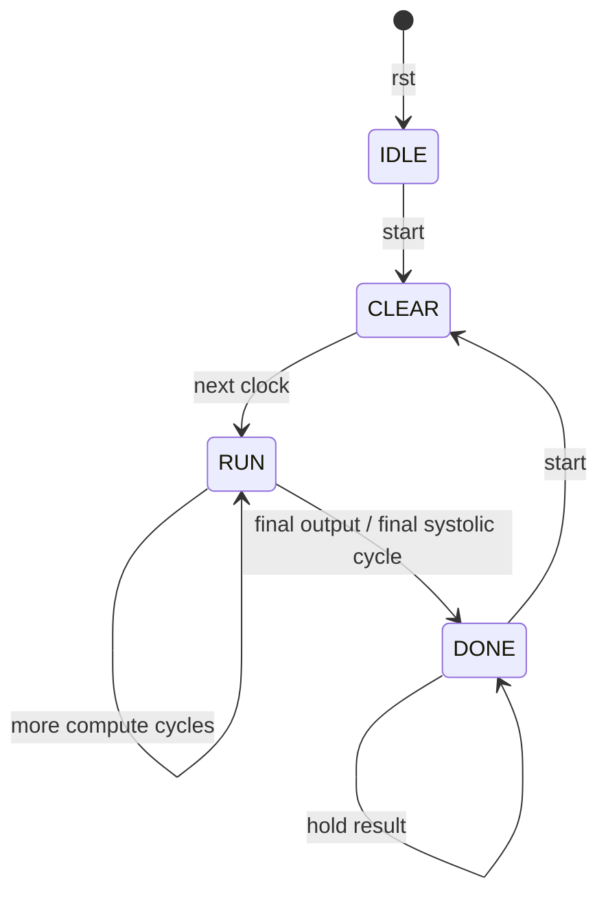

# Architecture

This project provides two implementations of `C = A x B` with the same
element-write, start/status, and indexed-result-read interface:

- The systolic implementation computes all outputs in parallel with an
  output-stationary `N x N` processing-element (PE) array.
- The sequential baseline reuses one multiply-accumulate (MAC) datapath for
  every output element.

The default configuration is `N = 3`, signed 8-bit operands, and signed 20-bit
accumulators. The diagrams show the parameterized structure; the PE grid is
drawn as 3x3 for readability.

## Shared host protocol

Write A with `wr_sel = 0` and B with `wr_sel = 1`, one element per clock.
Writes are ignored while `busy` is high. Pulse `start` for one clock in `IDLE`
or `DONE`, wait for `done`, then read each result by its row and column.
`done` stays high until another accepted start. `rst` is synchronous and
returns the controller to `IDLE`; matrix storage is not cleared by reset.

## Systolic implementation

Each PE forwards A one column to the right and B one row downward while
accumulating `A[i][k] * B[k][j]` locally into `C[i][j]`. The input interface
delays lane `i` by `i` clocks so each PE receives matching operands at
`t = i + j + k`. The controller asserts `clr` in `CLEAR`, then streams inputs
in `RUN`; for an `N x N` array, `RUN` lasts `3N - 2` clocks.

### PE dataflow

## Sequential baseline

In `RUN`, the controller iterates `k` for each output coordinate, then stores
the completed sum in C and advances through outputs in row-major order. The
same single MAC is reused for every output; computation takes `N^3` MAC clocks,
plus the one-clock `CLEAR` phase. Both implementations expose the same host
write and indexed-read behavior, but use separate top-level modules.

## Controller state transitions

`rst` synchronously returns either controller to `IDLE`. In the systolic
implementation, `CLEAR` clears every PE accumulator and forwarding register.
In the sequential baseline, `CLEAR` initializes its working accumulator and
iteration indices. In both, `busy` is high in `CLEAR` and `RUN`; `done` is high
in `DONE`.
